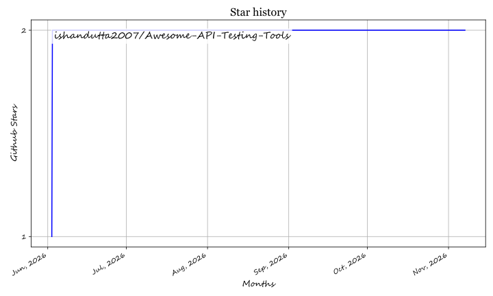

  

# 🚀 Awesome API Testing Tools 🧪

**A definitive, SEO-optimized curated index of premier SaaS platforms, HTTP interceptors, traffic mockers, load testing frameworks, and open-source API testing suites.**

*Elevate your API development lifecycle across REST, GraphQL, gRPC, WebSocket, and SOAP architectures.*

---

## 📑 Table of Contents
- [🌐 Sector Overview & Market Dynamics](#-sector-overview--market-dynamics)
- [💼 SaaS Products](#-saas-products)
- [💻 Open-Source GitHub Projects](#-open-source-github-projects)
- [🔍 Quick Comparison Matrix](#-quick-comparison-matrix)
- [🤝 How to Contribute](#-how-to-contribute)
- [💖 Support & Sponsorship](#-support--sponsorship)
- [⭐ Star History](#-star-history)
- [📄 Disclaimer & License](#-disclaimer--license)

---

## 🌐 Sector Overview & Market Dynamics

The global **API testing market** is valued at approximately **$2.1 billion to $2.8 billion (2025–2026)** and is projected to surpass **$6.5 billion by 2030**, advancing at a robust Compound Annual Growth Rate (CAGR) of **~19–22%**.

The sector demonstrates **moderate fragmentation with a bifurcated dynamic**: while incumbent enterprise giants like Postman and Kong command significant corporate market share, the ecosystem is rapidly diversifying toward privacy-centric, local-first, Git-versioned open-source clients (e.g., Bruno, Hoppscotch) and specialized traffic-interception and AI-driven regression engines.

---

## 💼 SaaS Products

The leading commercial platforms for API testing, mock services, traffic inspection, and cross-team collaboration. Sorted by company scale (valuation / annual revenue descending).

| Product | Company Valuation / Revenue | Starting Price | Free Tier / Free Trial Limits | Primary Focus & Highlights |
| :--- | :--- | :--- | :--- | :--- |
| **[Postman](https://www.postman.com/)** | **$5.6B Valuation** (~$313M ARR) | **$14/user/month** *(billed annually for Basic)* or $19/mo | **Free forever (1 user only)**: 10,000 Postman Cloud API calls/mo, 5 integrations, 50 AI credits/mo, unlimited local collection runs. | 🌐 Industry standard API lifecycle platform with collaborative workspaces, cloud runners, mock servers, and CI/CD monitors. |
| **[Insomnia](https://insomnia.rest/)** | **$2.0B Valuation** *(Kong Inc. parent, ~$100M+ ARR)* | **$10/user/month** *(billed annually for Pro)* or $12/mo | **Free forever (up to 3 users for Git Sync)**: Unlimited local & cloud projects, E2EE sync, 1,000 mock requests/mo, Scratch Pad (100% offline, no login required). | ⚡ Developer-first REST, GraphQL, and gRPC client with native Git sync, environment management, and Kong Konnect gateway alignment. |
| **[Telerik Fiddler](https://www.telerik.com/fiddler)** | **$1.8B Market Cap** *(Progress Software `PRGS`, ~$1B Rev)* | **$6/user/month** *(Fiddler Everywhere Lite)* or $12/mo Pro | **10-day full-featured free trial** with zero restrictions across all Pro features. Windows-only *Fiddler Classic* remains a free community-supported tool. | 🛡️ Comprehensive network proxy and traffic inspection tool for capturing, modifying, and debugging HTTP/HTTPS requests on desktop and mobile. |
| **[Hoppscotch](https://hoppscotch.io/)** | **~$15M–$25M Est. Valuation** *(Venture-backed OSS)* | **$6/user/month** *(billed annually for Business)* or $8/mo | **Free forever (unlimited personal use)**: Unlimited REST/GraphQL/WebSocket requests, personal collections, real-time testing, and self-hosted Community Edition. | 🍃 Ultra-fast, lightweight API client with web access, PWA support, team workspaces, and zero-friction real-time sockets. |
| **[Requestly](https://requestly.com/)** | **~$10M–$20M Est. Valuation** *(Seed / Early-Stage)* | **$8/user/month** *(billed annually for Lite)* or $12/mo | **Free forever (1 user)**: Capped at 5 total rules (3 concurrently active), 5 mock API endpoints, unlimited native API client requests. | 🔀 Network interception, URL redirects, header injection, API response mocking, and client-side bug reproduction. |
| **[HTTP Toolkit](https://httptoolkit.com/)** | **Indie / Bootstrapped** *(Self-sustaining SaaS/OSS)* | **$11.50/month** *(billed annually)* or $15/mo Pro | **Free forever (Hobbyist Plan)**: Unlimited standard HTTP/HTTPS interception, manual breakpoint rewriting, and filtering. *Free Pro for accredited students/faculty.* | 🔍 Automated zero-configuration proxy targeting Docker containers, mobile devices, node daemons, and browser sessions. |
| **[ModHeader](https://modheader.com/)** | **Indie / Micro-SaaS** *(High-volume browser extension)* | **$4.00/user/month** *(billed annually)* or $5/mo | **Free forever (with basic banner/prompts)**: Up to 3 profile presets, 2 URL redirects per profile, unlimited header addition/modification. | 🧩 Browser extension for rapid manipulation of HTTP request and response headers and cookies directly within Chrome/Edge/Firefox. |

---

## 💻 Open-Source GitHub Projects

Discover the highest-rated open-source API clients, mock servers, stress testing engines, and command-line test suites. Sorted by GitHub_Stars (descending).

| Project | GitHub_Stars | Language / Ecosystem | Category | Description |
| :--- | :--- | :--- | :--- | :--- |
| **[Hoppscotch](https://github.com/hoppscotch/hoppscotch)** |  | TypeScript / Vue | API Client & Platform | Open-source API development ecosystem. Extremely fast web and desktop application supporting REST, GraphQL, SSE, and WebSockets. |
| **[Bruno](https://github.com/usebruno/bruno)** |  | JavaScript | Local-First API Client | Revolutionary, offline-first Postman alternative that stores collections directly as plain text files in your Git repository. |
| **[curl](https://github.com/curl/curl)** |  | C | CLI Network Engine | The fundamental command-line tool and library for transferring data across 25+ network protocols, anchoring the foundation of all web testing. |
| **[Insomnia](https://github.com/Kong/insomnia)** |  | TypeScript | API Client & Design | Open-source core desktop client for designing, debugging, and testing REST, GraphQL, gRPC, and OpenAPI services. |
| **[HTTPie](https://github.com/httpie/cli)** |  | Python | CLI Client | Modern, user-friendly command-line HTTP client with intuitive syntax, colored terminal output, JSON formatting, and session persistence. |
| **[k6](https://github.com/grafana/k6)** |  | Go / JavaScript | Load & Performance Testing | Modern load testing tool by Grafana Labs for developers and QA engineers. Write expressive load tests in ES6 JavaScript. |
| **[Keploy](https://github.com/keploy/keploy)** |  | Go | E2E Regression & Mocking | Zero-code API testing platform that records network interactions (DB, gRPC, HTTP) to generate test cases and synthetic mocks automatically. |
| **[Artillery](https://github.com/artilleryio/artillery)** |  | JavaScript / Node.js | Load & Stress Testing | Cloud-native, distributed load testing and functional monitoring framework for high-scale HTTP, WebSocket, and Socket.io endpoints. |
| **[Karate](https://github.com/karatelabs/karate)** |  | Java | BDD Test Automation | Unified test framework combining API test-automation, mocks, performance testing, and UI automation into a concise DSL without boilerplate. |
| **[Mockoon](https://github.com/mockoon/mockoon)** |  | TypeScript | Local API Mocking | The easiest and quickest way to design and run local mock REST APIs with custom headers, body rules, latency simulation, and proxying. |
| **[xh](https://github.com/ducaale/xh)** |  | Rust | CLI Client | Blazingly fast, friendly CLI tool for sending HTTP requests. Built in Rust with native speed and seamless HTTPie compatibility. |
| **[WireMock](https://github.com/wiremock/wiremock)** |  | Java | Service Mocking & Stubbing | Flexible tool for mocking HTTP services, simulating edge-case responses, faults, network latency, and verifying API client calls. |
| **[Newman](https://github.com/postmanlabs/newman)** |  | JavaScript | CI/CD Runner | Official command-line collection runner for Postman that allows running and testing Postman collections directly in CI pipelines. |
| **[REST Assured](https://github.com/rest-assured/rest-assured)** |  | Java | Integration Testing | Java DSL for simplified, fluent testing of REST services with automatic XML and JSON response parsing and assertion matchers. |
| **[REST Client (VS Code)](https://github.com/Huachao/vscode-restclient)** |  | TypeScript | IDE Extension | Send HTTP requests and view responses directly within Visual Studio Code via `.http` and `.rest` text files. |
| **[HTTP Toolkit](https://github.com/httptoolkit/httptoolkit)** |  | TypeScript | Interceptor & Proxy | Beautiful open-source HTTP debugging proxy. Intercepts traffic from browsers, terminals, mobile devices, and Docker with zero setup. |
| **[Step CI](https://github.com/stepci/stepci)** |  | TypeScript | Automated API Testing | Declarative API quality assurance framework for REST, GraphQL, and gRPC with self-healing tests, mock servers, and pipeline alerts. |
| **[Restish](https://github.com/danielgtaylor/restish)** |  | Go | CLI Client | Modern CLI for interacting with RESTful services with automatic OpenAPI schema discovery and smart authentication handling. |
| **[httpYac](https://github.com/AnWeber/httpyac)** |  | TypeScript | CLI & IDE Engine | Quickly test REST, SOAP, GraphQL, and WebSocket requests stored in plain `.http` or `.rest` files with rich scripting hooks. |
| **[Parlel](https://github.com/dksingh1997/parlel)** |  | Shell / Docker | Service Emulators | 250+ service emulators (Stripe, Postgres, Slack, S3, Kafka) on local Docker, speaking wire protocols so unmodified clients run on localhost. |
| **[Wayfarer](https://github.com/AshwinSathian/wayfarer)** |  | TypeScript / Angular | Local-First API Client | Browser-based, account-free API client with an encrypted secrets vault, Postman, Insomnia, OpenAPI, HAR and cURL import, Postman-style scripts in a QuickJS sandbox, and a CLI for CI runs. |

---

## 🔍 Quick Comparison Matrix

| Use Case | Recommended SaaS | Recommended Open-Source | Key Strengths |
| :--- | :--- | :--- | :--- |
| **Team Collaboration & Governance** | [Postman](https://www.postman.com/) | [Hoppscotch](https://github.com/hoppscotch/hoppscotch) | Central workspaces, shared history, RBAC, access auditing. |
| **Local-First & Git-Controlled** | [Insomnia](https://insomnia.rest/) | [Bruno](https://github.com/usebruno/bruno) | Plain `.bru` / git repo storage, no cloud lock-in, offline first. |
| **Network Interception & Proxy** | [Telerik Fiddler](https://www.telerik.com/fiddler) | [HTTP Toolkit](https://github.com/httptoolkit/httptoolkit) | Mobile app inspection, Docker bridge capture, SSL decryption. |
| **Fast CLI & Terminal Automation** | [Requestly](https://requestly.com/) | [HTTPie](https://github.com/httpie/cli) / [xh](https://github.com/ducaale/xh) | Colored terminal outputs, script piping, instant curl compatibility. |
| **Load & Stress Testing** | N/A | [k6](https://github.com/grafana/k6) / [Artillery](https://github.com/artilleryio/artillery) | High RPS, multi-protocol benchmarking, CI integration. |
| **Automated Mocking & Stubbing** | [Requestly](https://requestly.com/) | [Mockoon](https://github.com/mockoon/mockoon) / [WireMock](https://github.com/wiremock/wiremock) | Fault injection, delayed responses, proxy pass-through. |

---

## 🤝 How to Contribute

Contributions are welcome! Please follow these guidelines:

1. **Fork** this repository.
2. **Add or modify** your tool in the appropriate table:
   - For SaaS products: Provide Name, Company Valuation/Revenue, Starting Price, Free Tier Limits, and Description.
   - For Open-Source projects: Provide Repo Link, Stars_Badge (`style=social&color=white` linking to stargazers), Language, Category, and Description.
3. Keep descriptions concise, factual, and strictly objective.
4. Submit a **Pull Request** with a brief summary of the addition.

---

## 💖 Support & Sponsorship

Thank you so much for exploring and using **Awesome API Testing Tools**! Maintaining and continually updating this curated directory takes ongoing time and care.

If you find this list useful:
- ⭐ **Star** this repository to help others discover it!
- 🍴 **Fork** and contribute your favorite tools or insights!
- 📢 **Share** it with fellow backend developers, QA engineers, and DevOps teams!
- ☕ **Buy me a coffee / Sponsor**: If you'd like to back this project financially and fuel future open-source developer tool initiatives, consider supporting via the [**GitHub Sponsors Dashboard**](https://github.com/sponsors/ishandutta2007). Every bit of support is deeply appreciated!

---

## ⭐ Star History

---

## 📄 Disclaimer & License

- This is a community-curated repository intended for educational and developer productivity purposes.
- Trademarks, product names, and logos belong to their respective corporate owners.
- Distributed under the [MIT License](LICENSE).

## ⭐ Star History

<a href="https://star-history.com/#ishandutta2007/Awesome-API-Testing-Tools&Timeline" align="center">
  <picture>
    <source media="(prefers-color-scheme: dark)" srcset="assets/ishandutta2007_Awesome-API-Testing-Tools_growth.svg">
    
  </picture>
</a>
